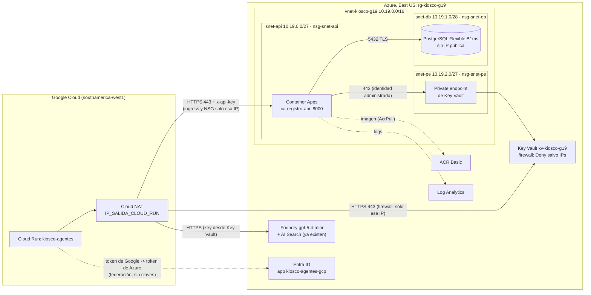

# Infraestructura Azure — Kiosco Escolar Saludable (Grupo 19)

Responsable: Benjamín. Todo está como scripts `az` listos para correr: base de datos, API de registro, Key Vault, redes y NSG (requisitos Magíster) y la federación de identidad con Cloud Run. Foundry (`gpt-5.4-mini`) y AI Search (`kiosco-g19-search`) ya existen en East US, en otro grupo, y estos scripts no los tocan.

| Script | Qué hace |
|---|---|
| `variables.sh` | Nombres, rangos de red y opciones. Lo cargan todos los scripts; cada variable se puede cambiar con `export` |
| `desplegar_azure.sh` | Crea todo: NSG, VNet, Key Vault, PostgreSQL, ACR, imagen, identidad y la API |
| `cargar_secretos.sh` | Carga en Key Vault las claves de Foundry, AI Search y Gemini; rota `registro-api-key` |
| `federacion_gcp.sh` | App de Entra ID que confía en la cuenta de servicio de Cloud Run (sin claves) |
| `verificar.sh` | Prueba la API desplegada y muestra la configuración de red (evidencia para el informe) |
| `cerrar_acceso_admin.sh` | Quita tu IP de los firewalls al terminar |
| `destruir.sh` | Borra solo los recursos que creó `desplegar_azure.sh`, uno por uno (con confirmación). Nunca el grupo: Foundry y AI Search quedan intactos |

La API está en `../api_registro/` (ver su README).

## Arquitectura de red



Vista en texto:

```
Cloud Run ──(IP fija Cloud NAT)──┬─ 443 ──> [ingress con restricción de IP] API (snet-api) ──5432──> PostgreSQL (snet-db, privado)
                                 │                                            └──443──> private endpoint (snet-pe) ──> Key Vault
                                 ├─ 443 ──> Key Vault (firewall: solo esa IP) ← secretos de los agentes
                                 └─ 443 ──> Foundry / AI Search (East US)
Colegio (on-premise) ──> Cloud Run (agentes); opcionalmente IP_COLEGIO también llega a la API
```

### Tabla de subredes (para el informe)

| Subred | Rango | IPs utilizables* | Delegación | NSG | Qué contiene |
|---|---|---|---|---|---|
| `snet-api` | 10.19.0.0/27 | 27 | `Microsoft.App/environments` | `nsg-snet-api` | Entorno de Container Apps (workload profiles, mínimo /27) con la API de registro |
| `snet-db` | 10.19.1.0/28 | 11 | `Microsoft.DBforPostgreSQL/flexibleServers` | `nsg-snet-db` | PostgreSQL Flexible Server, acceso privado + zona DNS privada `psql-kiosco-g19.private.postgres.database.azure.com` |
| `snet-pe` | 10.19.2.0/27 | 27 | — (políticas de red de private endpoint activadas) | `nsg-snet-pe` | Private endpoint de Key Vault + zona DNS privada `privatelink.vaultcore.azure.net` |

\* Azure reserva 5 IPs por subred. VNet `vnet-kiosco-g19` 10.19.0.0/16 (el 19 es por el grupo), queda espacio para más subredes.

### Tabla de reglas NSG (para el informe)

Además de estas reglas, cada NSG trae las reglas por defecto de Azure (65000+), que quedan anuladas por los "Denegar" explícitos.

| NSG | Prioridad | Dirección | Acción | Nombre | Protocolo | Origen | Destino | Puerto | Motivo |
|---|---|---|---|---|---|---|---|---|---|
| nsg-snet-api | 100 | Entrada | Permitir | Permitir-HTTPS-clientes | TCP | IP_SALIDA_CLOUD_RUN, IP_COLEGIO, IP_ADMIN† | 10.19.0.0/27 | 443 | Solo Cloud Run, el colegio y el admin llegan a la API |
| nsg-snet-api | 110 | Entrada | Permitir | Permitir-AzureLoadBalancer | Todos | AzureLoadBalancer | 10.19.0.0/27 | * | Sondas de salud del balanceador |
| nsg-snet-api | 120 | Entrada | Permitir | Permitir-intra-subred-entrada | Todos | 10.19.0.0/27 | 10.19.0.0/27 | * | Componentes del entorno entre sí |
| nsg-snet-api | 4096 | Entrada | Denegar | Denegar-todo-entrada | Todos | * | * | * | Todo lo demás |
| nsg-snet-api | 100 | Salida | Permitir | Permitir-PostgreSQL | TCP | 10.19.0.0/27 | 10.19.1.0/28 | 5432 | La API usa la BD |
| nsg-snet-api | 110 | Salida | Permitir | Permitir-KeyVault-PE | TCP | 10.19.0.0/27 | 10.19.2.0/27 | 443 | Secretos por el private endpoint |
| nsg-snet-api | 120 | Salida | Permitir | Permitir-intra-subred-salida | Todos | 10.19.0.0/27 | 10.19.0.0/27 | * | Componentes del entorno entre sí |
| nsg-snet-api | 130 | Salida | Permitir | Permitir-EntraID | TCP | 10.19.0.0/27 | AzureActiveDirectory | 443 | Token de la identidad administrada |
| nsg-snet-api | 140 | Salida | Permitir | Permitir-MCR | TCP | 10.19.0.0/27 | MicrosoftContainerRegistry | 443 | Imágenes del sistema de Container Apps |
| nsg-snet-api | 150 | Salida | Permitir | Permitir-FrontDoor-MCR | TCP | 10.19.0.0/27 | AzureFrontDoor.FirstParty | 443 | Dependencia de MCR |
| nsg-snet-api | 160 | Salida | Permitir | Permitir-ACR | TCP | 10.19.0.0/27 | AzureContainerRegistry | 443 | Imagen de la API |
| nsg-snet-api | 170 | Salida | Permitir | Permitir-Storage-ACR | TCP | 10.19.0.0/27 | Storage | 443 | Capas de la imagen (Blob Storage del ACR) |
| nsg-snet-api | 180 | Salida | Permitir | Permitir-AzureMonitor | TCP | 10.19.0.0/27 | AzureMonitor | 443 | Logs a Log Analytics |
| nsg-snet-api | 190 | Salida | Permitir | Permitir-DNS-Azure | Todos | 10.19.0.0/27 | 168.63.129.16/32 | 53 | DNS de Azure (zonas privadas) |
| nsg-snet-api | 4000 | Salida | Denegar | Denegar-salida-Internet | Todos | * | Internet | * | La API no navega a Internet |
| nsg-snet-db | 100 | Entrada | Permitir | Permitir-PostgreSQL-desde-API | TCP | 10.19.0.0/27 | 10.19.1.0/28 | 5432 | La BD solo acepta a la API |
| nsg-snet-db | 110 | Entrada | Permitir | Permitir-intra-subred-entrada | Todos | 10.19.1.0/28 | 10.19.1.0/28 | * | Tráfico interno del servicio administrado |
| nsg-snet-db | 4096 | Entrada | Denegar | Denegar-todo-entrada | Todos | * | * | * | Todo lo demás, incluido Internet |
| nsg-snet-db | 100 | Salida | Permitir | Permitir-intra-subred-salida | Todos | 10.19.1.0/28 | 10.19.1.0/28 | * | Tráfico interno del servicio administrado |
| nsg-snet-db | 110 | Salida | Permitir | Permitir-Storage-respaldos | TCP | 10.19.1.0/28 | Storage | 443 | Respaldos y WAL del servicio |
| nsg-snet-db | 4000 | Salida | Denegar | Denegar-salida-Internet | Todos | * | Internet | * | La BD no sale a Internet |
| nsg-snet-pe | 100 | Entrada | Permitir | Permitir-KeyVault-desde-API | TCP | 10.19.0.0/27 | 10.19.2.0/27 | 443 | Solo la API usa el private endpoint |
| nsg-snet-pe | 4096 | Entrada | Denegar | Denegar-todo-entrada | Todos | * | * | * | Todo lo demás |
| nsg-snet-pe | 4096 | Salida | Denegar | Denegar-todo-salida | Todos | * | * | * | Un private endpoint no inicia conexiones (el NSG tiene estado: las respuestas pasan) |

† `IP_ADMIN` (la de Benjamín) es temporal: `cerrar_acceso_admin.sh` la quita al terminar.

**Otros controles de acceso (no son NSG, también van al informe):**

| Control | Configuración |
|---|---|
| Ingress de la API | HTTPS (HTTP redirige), restricción de IP: Allow `IP_SALIDA_CLOUD_RUN` (+ colegio, + admin temporal); todo lo demás 403. Además exige `x-api-key` |
| Firewall de Key Vault | Acceso público habilitado **solo** para la lista de IPs (acción por defecto `Deny`): IP fija de Cloud Run (+ admin temporal). La API entra por el private endpoint |
| PostgreSQL | Acceso privado (integración con VNet), `publicNetworkAccess = Disabled`, TLS obligatorio |
| Key Vault, permisos (RBAC) | API (identidad administrada): `Key Vault Secrets User` solo sobre `registro-api-key` y `registro-database-url`. Cloud Run (app federada): `Key Vault Secrets User` solo sobre los 4 secretos de §4.5. Benjamín: `Key Vault Secrets Officer` |
| ACR | Sin usuario admin; la API descarga con su identidad (`AcrPull`) |

## Guía paso a paso para Benjamín

Tiempo total: ~45 minutos, casi todo esperando a Azure. Las capturas van a `proyecto2/informe/capturas/` con el nombre indicado. **En ninguna captura debe verse una clave** (en el portal, no abras "Mostrar valor secreto").

### 0. Prerrequisitos

1. **Dónde correr los scripts** (elige uno):
   - **Git Bash en Windows** con [Azure CLI](https://aka.ms/installazurecliwindows) instalado (recomendado: tu IP es estable y los scripts ya manejan las rutas de Windows).
   - **WSL / Linux / Mac** con Azure CLI.
   - **Azure Cloud Shell (Bash)** en el portal: ya trae `az` y la sesión iniciada, pero su IP cambia si la sesión se reinicia (tendrías que volver a correr `desplegar_azure.sh`), y no tiene Docker para el plan B.
2. Sesión y suscripción del curso:
   ```bash
   az login
   az account list -o table                 # busca la del curso
   az account set --subscription "<nombre o id>"
   az role assignment list --assignee "$(az ad signed-in-user show --query id -o tsv)" --include-inherited -o table
   ```
   Necesitas **Owner** (o Contributor + User Access Administrator) en la suscripción o en el grupo `rg-kiosco-g19`, porque los scripts asignan roles. Con Azure for Students eres Owner.
3. Proveedores: `desplegar_azure.sh` registra solo los que falten (`Microsoft.App`, `Microsoft.OperationalInsights`, `Microsoft.ContainerRegistry`, `Microsoft.DBforPostgreSQL`, `Microsoft.KeyVault`, `Microsoft.Network`, `Microsoft.ManagedIdentity`).
4. Pídele a Max (no son secretos): la **IP fija de salida de Cloud Run** (`IP_SALIDA_CLOUD_RUN`, de Cloud NAT) y el **ID numérico de la service account** (`GCP_SA_UNIQUE_ID`). Si todavía no tiene la IP, puedes desplegar igual y volver a correr el paso 1 cuando la tenga.

### 1. Desplegar (≈ 30 min)

```bash
cd proyecto2/infra
export IP_SALIDA_CLOUD_RUN=<IP de Max>      # ej. 34.176.10.20, sin /32
# export IP_COLEGIO=<IP pública del colegio> # opcional
# Si un nombre ya existe en Azure (son únicos globales):
# export KV_NOMBRE=kv-kiosco-g19-b  ACR_NOMBRE=acrkioscog19b  PG_NOMBRE=psql-kiosco-g19-b
bash desplegar_azure.sh
```

Al final imprime `REGISTRO_API_URL`, `KEY_VAULT_URL` y `AZURE_TENANT_ID`. Si se corta, vuelve a correrlo: lo que ya existe se salta.

Capturas:
- `azure_01_recursos.png`: el grupo `rg-kiosco-g19` en el portal con la lista de recursos.
- `azure_02_vnet_subredes.png`: `vnet-kiosco-g19` → Subredes (rangos, delegación, NSG).
- `azure_03_nsg_api.png`, `azure_04_nsg_db.png`, `azure_05_nsg_pe.png`: cada NSG → Reglas de seguridad de entrada y de salida.
- `azure_06_keyvault_redes.png`: Key Vault → Redes (firewall con las IPs y la pestaña de conexiones de private endpoint).
- `azure_07_keyvault_secretos.png`: Key Vault → Secretos (solo la lista de nombres).
- `azure_08_keyvault_iam.png`: un secreto (`registro-api-key`) → Control de acceso (IAM) → Asignaciones de roles.
- `azure_09_postgres_redes.png`: PostgreSQL → Redes ("Acceso privado (integración con VNet)", sin acceso público).
- `azure_10_containerapp_ingress.png`: `ca-registro-api` → Ingress (restricciones de IP) y → Secretos (referencias a Key Vault, sin valores).

### 2. Verificar (≈ 3 min)

```bash
bash verificar.sh
```

Debe terminar con `0 con falla`. Prueba `/salud`, 401 sin clave y con clave errónea, 201, 422 (APTO con sellos, sello inválido, veredicto inválido), NO_APTO con sellos vacía, GET con `kiosco_id` y `desde`, que PostgreSQL no sea alcanzable desde Internet, y muestra el firewall de Key Vault, el ingress y las reglas de los NSG. Lee la clave de Key Vault sin mostrarla. Los chequeos de prueba quedan con `kiosco_id = verificacion-infra`.

Capturas:
- `azure_11_verificar.png`: la salida completa de `verificar.sh`.
- `azure_12_logs_rechazos.png`: Log Analytics `log-kiosco-g19` → Registros, con la consulta que imprime el script (aparecen `rechazo_401` y `rechazo_apto_con_sellos`; esperar 5 min).

### 3. Cargar los secretos de los agentes (≈ 2 min)

Sin copiar ni pegar claves, leyéndolas directo de Azure (cambia los grupos por los reales de Foundry y AI Search):

```bash
FOUNDRY_RECURSO=kiosco-g19-foundry FOUNDRY_RG=<grupo de Foundry> SEARCH_RG=<grupo de AI Search> bash cargar_secretos.sh
```

La key de Gemini te la pasa Max por mensaje privado: el script la pide sin mostrarla (pégala y borra el mensaje). `registro-api-key` ya la generó el paso 1.

### 4. Federación con Cloud Run (≈ 2 min)

```bash
GCP_SA_UNIQUE_ID=<ID numérico que te pasó Max> bash federacion_gcp.sh
```

Imprime `AZURE_TENANT_ID`, `AZURE_CLIENT_ID` y `KEY_VAULT_URL` para Max. Captura `azure_13_federacion.png`: Entra ID → Registros de aplicaciones → `kiosco-agentes-gcp` → Certificados y secretos → **Credenciales federadas** (issuer, subject, audience).

### 5. Pasarle a Max y cerrar

**Por el chat del grupo (no son secretos):** `REGISTRO_API_URL`, `KEY_VAULT_URL`, `AZURE_TENANT_ID`, `AZURE_CLIENT_ID`, y la confirmación de que están los 4 secretos de §4.5. Max los pone como variables de Cloud Run con `REGISTRO_BACKEND=api`.

**Nunca al repo ni al chat:** el valor de `registro-api-key`, de `registro-database-url` (trae la contraseña de la BD) ni de ninguna key. Max las lee de Key Vault desde Cloud Run; para probar en su computador puede pedirte la `registro-api-key` por mensaje privado.

Cuando Max confirme que Cloud Run guarda chequeos:

```bash
bash cerrar_acceso_admin.sh    # quita tu IP del ingress, de Key Vault y del NSG
```

Para volver a entrar (más pruebas o capturas), corre de nuevo `desplegar_azure.sh` (vuelve a agregar tu IP; también reconstruye la imagen y publica otra revisión).

### Operación

| Tarea | Comando |
|---|---|
| Logs de la API en vivo | `az containerapp logs show -g rg-kiosco-g19 -n ca-registro-api --follow` |
| Logs del sistema (si no arranca) | `az containerapp logs show -g rg-kiosco-g19 -n ca-registro-api --type system` |
| Nueva versión de la API | `bash desplegar_azure.sh` (idempotente) |
| Rotar `registro-api-key` | `ROTAR_API_KEY=true bash cargar_secretos.sh` y avisar a Max (Cloud Run debe reiniciarse). Container Apps puede tardar hasta 30 min en traer la versión nueva de Key Vault: si `verificar.sh` da 401 con la clave nueva, reinicia la revisión otra vez |
| Cambió la IP de Cloud Run | `IP_SALIDA_CLOUD_RUN=<nueva> bash desplegar_azure.sh` (la IP vieja hay que quitarla a mano del firewall de Key Vault, de la regla NSG y del ingress) |
| Borrar lo nuestro después de la entrega (Foundry y las KB quedan) | `bash destruir.sh` |

## Supuestos

- Región East US para todo, igual que Foundry (menos latencia entre la API y la BD; Foundry no depende de esta red).
- Volumen (de `../agentes/COSTOS_Y_ESCALABILIDAD.md`): por kiosco ~900 registros y ~40 reportes al mes; en el pico sincronizado, 0,022 consultas/s por kiosco. Con 50 kioscos son ~1,1 peticiones/s y ~47.000 al mes: una réplica de 0,25 vCPU y una B1ms sobran.
- Cada chequeo pesa ~300 bytes: 50 kioscos durante un año son ~540.000 filas (~0,2 GB) de los 32 GiB.
- Cloud Run sale a Internet por una IP fija (Cloud NAT con conector VPC o salida directa de VPC); sin ella, la restricción por IP no sirve.

## Costos mensuales estimados (USD, East US, precio de lista, 730 h)

| Recurso | Configuración | USD / mes | Confianza |
|---|---|---|---|
| PostgreSQL Flexible, cómputo | Burstable B1ms (1 vCore, 2 GiB), 24/7 | ≈ 12,41 | Estimación, **confirmar en la calculadora** |
| PostgreSQL, almacenamiento | 32 GiB × ≈ US$0,115 | ≈ 3,68 | Estimación, confirmar |
| PostgreSQL, respaldos | 7 días | 0 (gratis hasta el 100 % del almacenamiento) | Estimación, confirmar |
| Container Apps | 1 réplica mínima de 0,25 vCPU / 0,5 GiB, casi siempre inactiva (tarifa idle ≈ US$0,000003 por vCPU-s y por GiB-s, menos la capa gratis mensual de 180.000 vCPU-s, 360.000 GiB-s y 2 M de peticiones) | ≈ 4,30 (≈ 0 con `MIN_REPLICAS=0`) | Estimación, confirmar |
| Container Registry | Basic (≈ US$0,167 / día) | ≈ 5,00 | Estimación, confirmar |
| Private endpoint (Key Vault) | US$0,01 / hora + US$0,01 / GB | ≈ 7,30 | Estimación, confirmar |
| Zonas DNS privadas | 2 × US$0,50 | 1,00 | Estimación, confirmar |
| Key Vault Standard | US$0,03 / 10.000 operaciones; < 10.000 al mes | < 0,05 | Oficial (precio tomado de `../agentes/COSTOS_Y_ESCALABILIDAD.md`) |
| Log Analytics | < 1 GB al mes (5 GB gratis por cuenta de facturación) | ≈ 0 | Estimación |
| VNet, subredes, NSG, identidad administrada | — | 0 | Sin costo |
| IP pública / balanceador del entorno de Container Apps | administrado por Azure | 0 – 3,65 | **A confirmar** (no está claro si se cobra aparte en workload profiles) |
| Salida de datos | < 1 GB (100 GB gratis) | 0 | Estimación |
| **Total** | | **≈ 34 – 37** | |

**Por número de kioscos:** este total es **fijo** para 1, 10 y 50 kioscos, porque el tráfico de registro (≤ 47.000 peticiones al mes) cabe en la capa gratis de Container Apps y en una B1ms. Hay que sumarlo a los totales de Max (modelo, KB, Cloud Run). Desde ~500 kioscos con recreo sincronizado (≈ 11 peticiones/s) convendría subir la BD a B2s o General Purpose y fijar 2 réplicas mínimas (cifra a calcular si se pide). Para ahorrar en la entrega: `MIN_REPLICAS=0` (≈ –4 USD, pero con arranque en frío de varios segundos y el cliente espera 10 s) y `destruir.sh` después del 17 nov.

## Limitaciones y plan B

| Riesgo | Señal | Plan B |
|---|---|---|
| **No se pueden crear app registrations** (Entra ID del curso las bloquea) | `federacion_gcp.sh` falla en el paso 1 | (a) Pedir al profesor o al administrador del tenant que cree `kiosco-agentes-gcp` con la credencial federada (el JSON está en el script) y te dé `AZURE_CLIENT_ID`. (b) Si se permite una app pero no la federación: **service principal con secret** guardado directo en Secret Manager de Google, sin pasar por pantalla ni chat: `az ad app credential reset --id <appId> --years 1 --query password -o tsv \| gcloud secrets versions add azure-client-secret --data-file=- --project kiosco-g19-agentes` (lo corre quien tenga acceso a los dos lados) y Cloud Run usa `AZURE_CLIENT_SECRET` (`DefaultAzureCredential` lo toma solo). Es un secreto de larga duración: rotarlo con el mismo comando antes de que venza y declararlo como limitación. (c) Si nada de eso: los agentes siguen con Secret Manager de Google (estado actual) y Key Vault queda solo para la API; se declara en el informe |
| No tienes permiso para asignar roles (no eres Owner) | "AuthorizationFailed" en `role assignment create` | Pedir al profesor el rol "Role Based Access Control Administrator" sobre `rg-kiosco-g19` |
| ACR Tasks bloqueado en la suscripción (pasa en algunas de estudiante) | `az acr build` falla con "TasksOperationsNotAllowed" o similar | Con Docker Desktop abierto: `USAR_DOCKER_LOCAL=true bash desplegar_azure.sh` |
| PostgreSQL Flexible restringido en East US para la suscripción | "location is restricted" al crear el servidor | Desplegar todo en otra región: `UBICACION=eastus2 bash desplegar_azure.sh` (antes, `destruir.sh` si quedó algo a medias). Foundry sigue en East US |
| Las reglas NSG estrictas de salida impiden aprovisionar el entorno o descargar la imagen | El entorno queda en estado fallido, o la revisión no arranca con "ImagePullBackOff" | `NSG_SALIDA_ESTRICTA=false bash desplegar_azure.sh` (quita solo "Denegar-salida-Internet"; el resto de las reglas sigue) y anotarlo en el informe. Las reglas requeridas se basaron en <https://learn.microsoft.com/azure/container-apps/firewall-integration>: revisarlas ahí si cambian |
| La API no logra leer Key Vault por la red privada | Revisión con error "secret ... keyvault" en `az containerapp logs show --type system` | Revisar que la zona `privatelink.vaultcore.azure.net` esté enlazada a la VNet y que el private endpoint esté "Approved" (`verificar.sh` lo muestra) |
| Cambió tu IP durante el despliegue | `verificar.sh` da 403 o no puede leer Key Vault | Vuelve a correr `desplegar_azure.sh` |

Otras limitaciones a declarar:
- La API usa el usuario administrador de PostgreSQL (ver `../api_registro/README.md`); lo ideal es autenticación de Entra ID con la identidad administrada.
- Sin alta disponibilidad (la B1ms no la tiene) ni réplica en otra región: si East US cae, el registro no está disponible (los agentes siguen respondiendo y devuelven un error controlado al guardar).
- Key Vault con acceso público "habilitado con lista de IPs" y no "deshabilitado", porque Cloud Run está fuera de Azure y no puede usar el private endpoint. La protección real es la lista de IPs + RBAC por secreto + federación.
- La restricción por IP depende de que Cloud Run salga siempre por Cloud NAT.
- Soft delete de Key Vault en 7 días y sin purge protection, para poder recrearlo durante el curso; en producción serían 90 días con purge protection.
- Los precios marcados "confirmar" no se pudieron validar contra la calculadora oficial desde este equipo.
